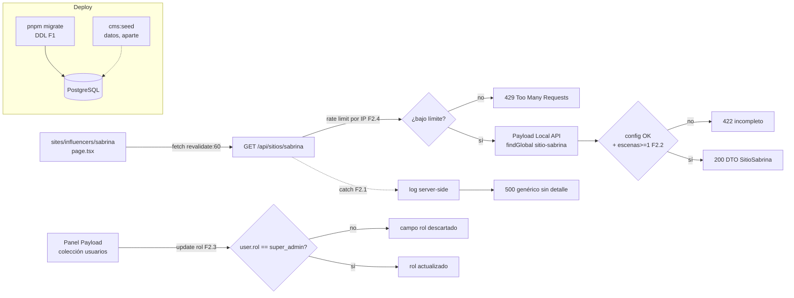

# Diseño — Hardening del CMS y baseline de migraciones para deploy

**Cambio:** `2026-06-chore-hardening-cms-deploy`
**Tipo:** chore
**Estructural:** false

> Documento técnico estable. Lo escribe `/fg-design`. `/fg-implement` no lo edita (las
> decisiones que surjan en el código van a `decisiones.md`, append-only).

---

## Enfoque

El incremento endurece el motor `apps/cms` existente sin tocar el contrato de datos ni el
sitio. Son cinco intervenciones acotadas, agrupadas en dos frentes independientes que no se
acoplan entre sí.

**Proyecto no legacy.** El monorepo es greenfield (5 commits, primer commit 2026-06-21); el
mismo criterio ya quedó registrado en el cambio de Fase 1. Se omite el análisis de impacto con
`legacy-impact-analyzer` (paso 2b de `/fg-design`).

### Frente 1 — Baseline de migraciones de Payload

El hueco real no es el flag de `push`: `payload.config.ts:30` ya hace
`push: process.env["NODE_ENV"] !== "production"` (push en dev, false en prod). El bloqueante es
que **no existen migraciones generadas** (`src/migrations/` vacío) ni scripts `migrate` cableados,
así que con `NODE_ENV=production` el esquema no se crea ni se versiona.

Estrategia:

1. **Configurar el directorio de migraciones explícitamente** en el `postgresAdapter`
   (`migrationDir: path.resolve(__dirname, "src/migrations")`). Hoy Payload usa el default
   (`./src/migrations` relativo a la config), pero hacerlo explícito evita ambigüedad de cwd al
   correr el CLI desde la raíz del monorepo y deja el contrato visible.
2. **Generar la baseline** con `payload migrate:create` corriendo con `push` activo contra una
   base limpia, de modo que la migración generada describa el esquema completo actual (no un
   diff parcial). Ver decisión D2 para la forma exacta de la baseline y su validación.
3. **Commitear** los archivos resultantes en `apps/cms/src/migrations/` (Payload genera el `.ts`
   de la migración + actualiza `index.ts` del directorio). Son DDL, no datos.
4. **Cablear scripts** en `apps/cms/package.json`: `migrate`, `migrate:create`, `migrate:status`
   (y opcionalmente `migrate:fresh` para validación local). Todos vía el CLI `payload migrate*`,
   sin sumar dependencias (el CLI ya viene en `payload@3.85.1`).
5. **Dejar listo el cableado de deploy/CI** documentando que `pnpm --filter @axs/cms migrate`
   debe correr antes de `start` en producción. El pipeline real (Coolify/Docker) queda fuera de
   alcance — este incremento entrega el flujo, no la infra.

**Separación DDL / seed (no negociable):** la migración es solo schema (DDL). El seed
(`src/seed/`) carga datos de contenido y queda intacto y desacoplado: ni la migración invoca al
seed ni el seed crea schema. En prod corre `migrate` (DDL); el seed es una operación aparte,
manual y de dev/staging.

### Frente 2 — Hardening de la deuda registrada de Fase 1

Cuatro fixes independientes, todos sobre archivos ya existentes:

- **F2.1 — Fuga de internals en el 500** (`route.ts:257-262`). El catch devuelve
  `detalle: error.message` al cliente, lo que puede filtrar SQL, nombres de tabla o detalles del
  driver. Fix: logear el mensaje server-side (`payload.logger.error` si hay instancia disponible,
  o `console.error` como fallback en el catch) y devolver una respuesta genérica
  `{ error: "No se pudo obtener el sitio" }` sin `detalle`. El status 500 no cambia.
- **F2.2 — Guard de `hero.escenas` vacío** (`route.ts:32` y `:147`). La validación 422 actual
  cubre solo `config`; el hero se rellena con `?? []`, así que con escenas vacías el endpoint
  responde 200 y el `.parse()` del cliente (que exige `escenas.min(1)`) lanza un ZodError no
  tipado que `page.tsx` no captura. Fix: extender la guard de validación temprana para chequear
  `hero?.escenas?.length >= 1` y devolver 422 con mensaje claro
  (`{ error: "Contenido del sitio incompleto" }`, alineado con la 422 existente). Esto se evalúa
  **después** de leer el global, junto a la validación de `config`.
- **F2.3 — Auto-elevación de rol** (`Usuarios.ts:21-29`, `porTenant.ts`). Riesgo **confirmado
  explotable** por razonamiento sobre el modelo de Payload 3.x:
  - `access.update` de la colección = `accesoPorTenant`. Para un `tenant_editor` con `clienta`
    asignada retorna `{ clienta: { equals: clientaId } }`. **Su propio doc de usuario comparte
    ese `clienta`**, así que el filtro lo incluye → el editor puede actualizar su propio usuario.
  - El campo `rol` no tiene `access.update` a nivel field. En Payload 3.x, sin field-level
    access, todo usuario que pase el access de colección puede escribir el campo. Por lo tanto un
    `tenant_editor` puede setear `rol: "super_admin"` en su propio doc → privilege escalation.
  - Fix: agregar `access.update` al field `rol` que solo retorne `true` cuando
    `req.user?.rol === "super_admin"`. Esto preserva el flujo legítimo (un `super_admin` editando
    roles sí pasa) y bloquea el resto. Field-level access en Payload se evalúa por encima del
    access de colección: aunque el editor pueda guardar el doc, el campo `rol` queda inmutable
    para él (Payload descarta el valor entrante de un field cuyo `access.update` retorna false).
- **F2.4 — Rate limiting del endpoint público** `GET /api/sitios/sabrina`. Ver decisión D1 para
  la estrategia. Resumen: limiter in-memory por IP con ventana fija, sin dependencia nueva,
  suficiente para Fase 2 (tráfico bajo y cacheado, instancia única), con la limitación
  multi-instancia documentada explícitamente para revisar al cablear el deploy real.

### Consumidor / blast radius

`obtenerSitioSabrina()` (`packages/cms-client/src/cliente.ts`) es el único consumidor del
endpoint; lo usa `sites/influencers/sabrina/app/page.tsx`. Los fixes F2.1, F2.2 y F2.4 solo
afectan respuestas de error o de rate limit (500 sin `detalle`, escenas vacías → 422, exceso →
429); **el 200 con contenido válido sigue produciendo el DTO idéntico**, así que el consumidor no
se ve afectado en el camino feliz. F2.3 toca solo el panel de Payload (colección `usuarios`), no
el endpoint público. No hay tests que cubran estos símbolos (no hay suite — TDD off).

---

## Arquitectura

### Integración con el sistema existente



### Contratos de interfaz

**Scripts nuevos en `apps/cms/package.json`** (vía CLI de Payload, sin deps nuevas):

```jsonc
"migrate":        "payload migrate",          // aplica migraciones pendientes (prod)
"migrate:create": "payload migrate:create",   // genera una nueva migración desde el diff de schema
"migrate:status": "payload migrate:status",   // lista migraciones aplicadas / pendientes
"migrate:fresh":  "payload migrate:fresh"      // (validación local) drop + re-aplica todo
```

**`postgresAdapter` (modificado, `payload.config.ts`):**

```typescript
db: postgresAdapter({
  pool: { connectionString: process.env["DATABASE_URI"] ?? "" },
  push: process.env["NODE_ENV"] !== "production",   // sin cambio
  migrationDir: path.resolve(__dirname, "src/migrations"),   // nuevo: explícito
}),
```

**Field access en `rol` (modificado, `Usuarios.ts`):**

```typescript
{
  name: "rol",
  type: "select",
  // ...options, required, defaultValue sin cambio...
  access: {
    update: ({ req }) => req.user?.rol === "super_admin",
  },
}
```

**Rate limiter (nuevo módulo, `src/lib/rateLimit.ts`):** función pura testeable a futuro, sin
estado de framework. Firma orientativa:

```typescript
// Ventana fija en memoria del proceso. Devuelve si la request pasa y cuántas quedan.
export function consultarRateLimit(clave: string, ahora?: number): {
  permitido: boolean;
  restantes: number;
  reiniciaEn: number; // epoch ms del reset de la ventana
};
```

El `route.ts` deriva `clave` de la IP (`x-forwarded-for` primer hop, fallback
`x-real-ip`/`"desconocido"`) y, si `!permitido`, devuelve `429` con header `Retry-After` antes de
tocar Payload.

### Respuestas del endpoint (estado final)

| Caso | Status | Body |
|---|---|---|
| Contenido válido | 200 | DTO `SitioSabrina` (idéntico a hoy) |
| Exceso de requests | 429 | `{ error: "Demasiadas solicitudes" }` + `Retry-After` |
| Global ausente | 404 | `{ error: "Sitio no encontrado" }` (sin cambio) |
| `config` incompleto **o** `escenas` vacío | 422 | `{ error: "Contenido del sitio incompleto" }` |
| Error interno | 500 | `{ error: "No se pudo obtener el sitio" }` (sin `detalle`) |

`cms-client` ya trata cualquier `!res.ok` como `ErrorCms(status, ...)`, así que 429/422/500 caen
en el mismo camino de error existente sin cambio de contrato.

---

## Archivos afectados

```
apps/cms/payload.config.ts                       (modificado — migrationDir explícito)
apps/cms/package.json                            (modificado — scripts migrate*)
apps/cms/src/migrations/<timestamp>_baseline.ts  (nuevo — DDL baseline, generado por el CLI)
apps/cms/src/migrations/index.ts                 (nuevo — índice del directorio, generado)
apps/cms/src/collections/Usuarios.ts             (modificado — field access en rol)
apps/cms/src/app/api/sitios/sabrina/route.ts     (modificado — F2.1 500, F2.2 guard, F2.4 rate limit)
apps/cms/src/lib/rateLimit.ts                    (nuevo — limiter in-memory por IP)
```

Sin cambios en: `packages/cms-client/*` (contrato intacto), `sites/influencers/sabrina/*`,
`src/access/porTenant.ts` (el fix de rol va a nivel field, no a `accesoPorTenant`), `src/seed/*`
(DDL y seed quedan desacoplados).

---

## Riesgos técnicos

- **Baseline parcial.** Si `migrate:create` se corre contra una base que ya tiene el esquema
  pusheado pero con drift respecto del schema de la config, la migración podría no reproducir el
  estado limpio. Mitigación: la baseline se genera y valida sobre una base limpia (ver D2 y
  `tareas.md`), no sobre la base de dev pusheada en uso.
- **IP detrás de proxy.** El rate limit por IP depende de `x-forwarded-for`; en el deploy real
  detrás de un reverse-proxy hay que confiar solo en el primer hop fiable. Documentado como
  limitación a revisar al cablear infra (D1).
- **Field access y el primer super_admin.** El fix F2.3 no afecta `registerFirstUser` (Payload
  permite crear el primer usuario sin auth); el seed/bootstrap del primer `super_admin` sigue
  funcionando. Verificar en el smoke manual que un `super_admin` aún puede cambiar roles.
