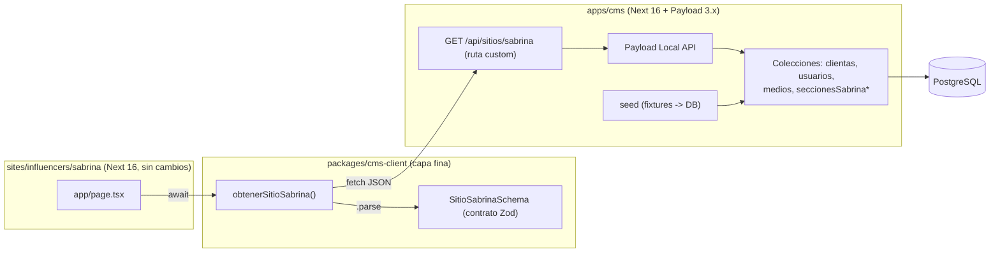

# Diseño — CMS headless de la Plataforma Axs sirviendo a Sabrina

**Cambio:** `2026-06-feat-cms-headless-sabrina`
**Estado:** diseñado
**Fase del PRD:** Fase 1 (CMS + sitio de Sabrina), acotada a dejar el CMS sirviendo el DTO del sitio.

---

## Enfoque

### Estrategia general

Levantar `apps/cms` como una **app Next 16 con Payload 3.x montado dentro** (Payload 3.x es
Next-native: no es un servidor aparte, se monta en el App Router de una app Next vía
`@payloadcms/next`). Sobre PostgreSQL con `@payloadcms/db-postgres`. El CMS modela el contenido
del sitio de Sabrina con **colecciones tipadas de Payload** (no el modelo genérico
`tipos_seccion` + `secciones` JSON), siembra el contenido actual de los fixtures como seed, y
expone una **ruta custom `/api/sitios/sabrina`** que ensambla y devuelve el DTO `SitioSabrina`
ya compuesto, validado por el mismo contrato Zod que hoy define `cms-client`.

Del lado de `packages/cms-client`, se cablea `obtenerSitioSabrina()` al fetch real (hoy
comentado), preservando firma y tipo de retorno. El consumidor (`sites/influencers/sabrina`)
no se toca.

El principio rector manda: **el CMS se adapta al contrato existente; el contrato no se
reinventa.** `SitioSabrinaSchema` y sus 13 partes son la fuente única de verdad del DTO. El
endpoint del CMS debe producir exactamente esa forma.

### Por qué colecciones tipadas y no el modelo genérico de `esquema.sql`

`docs/esquema.sql` propone un modelo genérico (`tipos_seccion` define el contrato como JSON,
`secciones` guarda instancias con `datos jsonb`). Es un modelo de referencia que documenta la
forma esperada, pero `esquema.sql` lo aclara explícitamente: *"Con Payload estas tablas se
generan desde la config; esto documenta la forma esperada."* Y `docs/convenciones.md` (sección
Payload) confirma la dirección: *"Payload autogenera los tipos TypeScript del modelo: úsalos."*

Modelar el contenido de Sabrina como `secciones.datos jsonb` genérico significaría que la
clienta editaría JSON crudo o que tendríamos que construir un constructor de formularios
dinámico sobre campos JSON — exactamente lo que Payload ya resuelve con sus field types. Las
colecciones tipadas dan: panel de edición por formularios listo, validación de campos, tipos TS
autogenerados, y columnas snake_case generadas por el adaptador (el adaptador depende de
`to-snake-case`, confirmado). El tradeoff (flexibilidad de tipos de sección en runtime) no es
necesario en este incremento: el sitio de Sabrina consume un DTO fijo y conocido. La
flexibilidad genérica es un problema de Fase 3 (onboarding de clientas nuevas), no de Fase 1.

Ver `decisiones.md` para el registro fundamentado de las tres decisiones técnicas.

### Por qué ruta custom y no API nativa de Payload

El contrato `SitioSabrina` es un **agregado**: compone 13 secciones bajo una sola raíz
(`config`, `hero`, `sobreMi`, `proposito`, `pilares`, `pack`, `comoTrabajo`, `experiencias`,
`testimonios`, `marcas`, `faq`, `contacto`, `redes`). La API REST nativa de Payload expone
**una colección por endpoint**; reconstruir el agregado del lado del cliente obligaría a
`cms-client` a hacer N fetches y ensamblar — rompiendo la capa fina y filtrando el modelado del
CMS al consumidor. El comentario que dejó preparado `cliente.ts` ya apunta a la ruta custom
(`${baseUrl}/api/sitios/sabrina`). Una ruta custom en el App Router del CMS lee las colecciones
del tenant Sabrina vía la Local API de Payload, arma el DTO y lo devuelve. El ensamblado vive
en el CMS (donde está el conocimiento del modelo), no en el cliente.

### Librerías y versiones (pineadas, `save-exact=true`)

| Paquete | Versión | Rol |
|---|---|---|
| `payload` | `3.85.1` | core del CMS |
| `@payloadcms/next` | `3.85.1` | montaje en el App Router de Next |
| `@payloadcms/db-postgres` | `3.85.1` | adaptador Postgres (genera columnas snake_case) |
| `@payloadcms/richtext-lexical` | `3.85.1` | editor de texto (peer que Payload espera para campos rich text) |
| `graphql` | `16.14.2` | peer de Payload — **debe ser 16.x, NO 17.x** (peer `^16.8.1`) |
| `sharp` | `0.35.2` | procesamiento de imágenes (media) |
| `next` | `16.2.9` | mismo pin que el sitio (peer de `@payloadcms/next`: `>=16.2.6 <17`) |
| `react` / `react-dom` | `19.2.7` | mismo pin que el sitio |

Gotcha de cadena de versiones (registrado en `decisiones.md`): `@payloadcms/next@3.85.1` declara
peer `graphql ^16.8.1`. El registry sirve `graphql@17.0.1` como `latest`; pinear esa versión
**rompe la resolución de peers**. Hay que pinear `graphql@16.14.2`. Con `auto-install-peers=true`
+ `save-exact=true`, las deps directas quedan pineadas exactas; revisar el diff del lockfile y
correr `pnpm audit` antes de commitear (PRD sección 8, vetting de cadena de suministro).

### Patrones que se siguen

- **Nomenclatura Payload** (`convenciones.md`): campos en camelCase español → API en camelCase
  (coincide con los DTOs) y columnas snake_case generadas por el adaptador. Slugs de colección
  en snake_case español plural (`clientas`, `secciones`, `medios`), alineados con `esquema.sql`.
- **DTO como contrato Zod**: el endpoint compone el objeto y `cms-client` lo valida con
  `SitioSabrinaSchema.parse()` en el borde. El contrato no cambia.
- **Capa fina en `cms-client`**: `obtenerSitioSabrina()` solo hace fetch + parse; ningún
  conocimiento del modelo del CMS se filtra al cliente ni al sitio.

---

## Arquitectura

### Integración con el sistema existente



### Modelo de datos del CMS (este incremento)

Colecciones que se modelan en Fase 1 (mínimo para servir el DTO de Sabrina + base multi-tenant):

- **`clientas`** (tenants): `nombre`, `slug` (unique), `dominio?`, `theme` (jsonb), `estaActiva`.
  Sabrina es el primer tenant (`slug: "sabrina"`).
- **`usuarios`**: `email` (unique), `rol` (`super_admin` | `tenant_editor`), relación a `clientas`.
  Es la colección de auth de Payload del panel.
- **`medios`**: upload collection de Payload (`url`, `textoAlternativo`/alt, `ancho`, `alto`),
  con relación al tenant. Mapea a `MedioSchema`.
- **Contenido del sitio de Sabrina**: se modela el contenido del DTO con campos tipados de
  Payload. Decisión de granularidad registrada en `decisiones.md`: una **colección/global de
  contenido del sitio por tenant** que agrupa los bloques del DTO como grupos/arrays tipados,
  versus colecciones separadas por sección. Se adopta el enfoque de **un Global de Payload
  `sitioSabrina` (o colección singleton por tenant)** que contiene los 13 bloques como `group`
  / `array` fields tipados, espejando 1:1 las 13 partes del `SitioSabrinaSchema`. Esto mantiene
  el agregado coherente y editable en una sola vista del panel, y hace trivial el ensamblado del
  endpoint. Las imágenes (`imagen`) se modelan como relaciones a `medios`.

Las colecciones `suscripciones`, `mantenimientos`, `pagos` quedan **fuera** (Fase 2). RLS a
nivel base queda **fuera** (opcional en el esquema; access control de Payload por tenant es el
mínimo de este incremento).

### Mapeo DTO ↔ contenido (las 13 partes del contrato)

El endpoint produce exactamente esta forma (de `packages/cms-client/src/esquemas.ts`):

| Clave DTO | Esquema Zod | Notas de modelado |
|---|---|---|
| `config` | `ConfigSitioSchema` | `nombre`, `acento`, `acentoSuave`, `whatsapp`, `instagram?`, `tiktok?`. Sale de `clientas` + grupo config. |
| `hero` | `SeccionHeroSchema` | `ctaPrimario`, `ctaSecundario`, `escenas[]` (`min(1)`); cada escena con `imagen: Medio`. |
| `sobreMi` | `SeccionSobreMiSchema` | `copete`, `titulo`, `parrafos[]`, `imagen`. |
| `proposito` | `SeccionPropositoSchema` | `icono`, `texto`. |
| `pilares` | `SeccionPilaresSchema` | `titulo`, `copete`, `pilares[]` (con `variante` enum default `compacto`). |
| `pack` | `SeccionPackSchema` | `etiqueta`, `titulo`, `descripcion`, `incluye[]`, `cita`, `imagen`. |
| `comoTrabajo` | `SeccionComoTrabajoSchema` | `copete`, `titulo`, `pasos[]`. |
| `experiencias` | `SeccionExperienciasSchema` | `experiencias[]` (con `imagen`), `tambienOrganizo[]`. |
| `testimonios` | `SeccionTestimoniosSchema` | `testimonios[]` (con `destacado` bool default `false`). |
| `marcas` | `SeccionMarcasSchema` | `copete`, `marcas[]` (strings). |
| `faq` | `SeccionFaqSchema` | `titulo`, `items[]` (`pregunta`/`respuesta`). |
| `contacto` | `SeccionContactoSchema` | `titulo`, `descripcion`. |
| `redes` | `SeccionRedesSchema` | `nombre`, `descripcion`, `redes[]`, `ubicacion`, `nota`. |

Cuidados del contrato a respetar en el modelado y el ensamblado:
- `escenas` tiene `.min(1)`: el modelo debe garantizar al menos una escena.
- `variante` (`PilarSchema`) y `destacado` (`TestimonioSchema`) tienen **defaults** Zod; el
  endpoint puede omitirlos y el `.parse()` los completa, pero el seed debe respetar los valores
  reales de los fixtures (`grande`/`compacto`/`banda`, `destacado: true/false`).
- `imagen` es `MedioSchema` (`url`, `textoAlternativo`, `ancho?`, `alto?`): el ensamblado mapea
  el doc de `medios` (relación) a esa forma. Las URLs de los fixtures son rutas a
  `public/assets` del sitio (`/assets/hero-1.png`); en Fase 1 el seed conserva esas URLs tal
  cual (el sitio ya tiene esos assets), sin subir binarios al media storage del CMS todavía.

### Contrato del endpoint

```
GET {baseUrl}/api/sitios/sabrina
200 -> application/json  con la forma exacta de SitioSabrinaSchema
4xx/5xx -> cms-client lanza ErrorCms(status, "No se pudo obtener el sitio")
```

`cms-client` (sin cambio de firma):

```ts
export async function obtenerSitioSabrina(opciones: OpcionesCliente = {}): Promise<SitioSabrina> {
  const baseUrl = opciones.baseUrl ?? process.env.NEXT_PUBLIC_CMS_URL /* o CMS_URL server-side */;
  const res = await fetch(`${baseUrl}/api/sitios/sabrina`, { next: { revalidate: 60 } });
  if (!res.ok) throw new ErrorCms(res.status, "No se pudo obtener el sitio");
  return SitioSabrinaSchema.parse(await res.json());
}
```

El nombre exacto de la variable de entorno de base URL es una decisión menor que se cierra en
`/fg-implement` (`CMS_URL` server-side es preferible: el fetch corre en un Server Component del
sitio). La firma pública (`OpcionesCliente { baseUrl? }`, retorno `Promise<SitioSabrina>`) no
cambia, así que `sites/influencers/sabrina/app/page.tsx` no se toca.

---

## Archivos afectados

Identificados con CodeGraph (`codegraph_explore`): el blast radius de `obtenerSitioSabrina` es
`sites/influencers/sabrina/app/page.tsx` (consumidor) + `packages/cms-client/src/index.ts`
(re-export). El de `SitioSabrinaSchema` es `cliente.ts` + `tipos.ts`. **Ningún test cubre estos
símbolos** (no hay suite). El consumidor del sitio **no** se modifica (firma preservada).

### `apps/cms` (nuevo — la app del CMS)

```
apps/cms/package.json                      (nuevo)  deps de Payload pineadas
apps/cms/tsconfig.json                     (nuevo)  extends tsconfig.base.json + plugin next
apps/cms/next.config.ts                    (nuevo)  withPayload(...)
apps/cms/payload.config.ts                 (nuevo)  config raíz: db-postgres, colecciones, admin
apps/cms/.env.example                      (nuevo)  DATABASE_URI, PAYLOAD_SECRET
apps/cms/src/collections/Clientas.ts       (nuevo)  colección clientas (tenants)
apps/cms/src/collections/Usuarios.ts       (nuevo)  colección auth (roles)
apps/cms/src/collections/Medios.ts         (nuevo)  upload collection (mapea MedioSchema)
apps/cms/src/globals/SitioSabrina.ts       (nuevo)  contenido del sitio: 13 bloques tipados
apps/cms/src/access/porTenant.ts           (nuevo)  access control por clienta
apps/cms/src/app/(payload)/...             (nuevo)  rutas del admin de Payload (App Router)
apps/cms/src/app/api/sitios/sabrina/route.ts (nuevo) ruta custom que ensambla y devuelve el DTO
apps/cms/src/seed/sabrina.ts               (nuevo)  seed desde los fixtures -> DB
apps/cms/src/seed/index.ts                 (nuevo)  runner del seed (script)
```

> El layout exacto de `src/app/(payload)` lo genera el scaffolding de `create-payload-app` /
> el template oficial de Payload 3.x; en `/fg-implement` se adopta esa estructura y se ajustan
> los paths. Los nombres de archivo de colecciones/globals son PascalCase (componentes/config),
> los slugs internos snake_case español.

### `packages/cms-client` (modificado)

```
packages/cms-client/src/cliente.ts         (modificado)  cuerpo de obtenerSitioSabrina: fetch real + ErrorCms
packages/cms-client/src/fixtures/sabrina.ts (sin cambio)  se conserva como fuente del seed; deja de ser la fuente en runtime
```

> `esquemas.ts`, `tipos.ts`, `index.ts` **no cambian**: el contrato es fijo. `fixtures/sabrina.ts`
> se mantiene en el repo (lo consume el seed del CMS); puede quedar marcado como dato de seed.

### Raíz del monorepo (modificado)

```
pnpm-workspace.yaml                        (sin cambio)  el glob apps/* ya cubre apps/cms
package.json (raíz)                         (modificado)  scripts cms:dev, cms:seed (opcional)
pnpm-lock.yaml                              (modificado)  nuevas deps pineadas de Payload
```

> `pnpm-workspace.yaml` ya declara `apps/*`, así que `apps/cms` entra al workspace sin tocar el
> glob. Se confirma en `/fg-implement`.

### Sin cambios (consumidor — verificado con CodeGraph)

```
sites/influencers/sabrina/app/page.tsx     (NO se toca)  firma de obtenerSitioSabrina preservada
sites/influencers/sabrina/components/*      (NO se tocan)
```

---

## Decisiones técnicas

Registradas en detalle, con fecha y razón, en `decisiones.md`. Resumen:

1. **Endpoint = ruta custom `/api/sitios/sabrina`** que ensambla el DTO agregado (vs. API REST
   nativa por colección). Razón: el DTO es un agregado de 13 secciones; el ensamblado pertenece
   al CMS, no al cliente. El contrato ya apunta a esta ruta.
2. **Modelado = colecciones/globals tipados de Payload** (vs. modelo genérico `tipos_seccion` +
   `secciones` JSON de `esquema.sql`). Razón: Payload favorece tipos; el panel de edición, los
   tipos TS y las columnas snake_case salen gratis; la flexibilidad genérica es problema de Fase 3.
3. **Versiones pineadas** de Payload 3.85.1 + adaptador Postgres + `graphql@16.14.2` (no 17.x,
   por peer constraint). Razón: `save-exact=true`, vetting de cadena de suministro, compatibilidad
   de peers con Next 16.2.9 / React 19.2.7 ya en el repo.

---

## Riesgos técnicos

- **Peer `graphql`**: pinear `graphql@17` (el `latest` del registry) rompe la resolución. Pin a
  `16.14.2`. Verificar con `pnpm install` + `pnpm audit` que no haya peers no resueltos.
- **Compatibilidad Next/React del CMS con el monorepo**: Payload 3.x exige Next `>=16.2.6 <17` y
  React 19; el repo ya está en Next 16.2.9 / React 19.2.7. Riesgo bajo, pero el CMS debe pinear
  exactamente las mismas versiones para evitar duplicados en el store de pnpm.
- **Paridad de contenido seed ↔ fixture**: el sitio debe renderizar exactamente lo mismo que hoy.
  El cierre verifica que el DTO servido por la ruta custom valide contra `SitioSabrinaSchema` y
  reproduzca el contenido de `fixtures/sabrina.ts` (incluidos defaults: `variante`, `destacado`,
  y el `\n` literal en títulos del hero).
- **Sin suite de tests** (TDD off): la validación de cierre es typecheck + lint + build +
  `pnpm audit` (más, manualmente, levantar el CMS y verificar que `/api/sitios/sabrina` devuelve
  un DTO que parsea). No se diseña ciclo TDD en este incremento.
- **Cambio estructural**: crea `apps/cms`, suma dependencias mayores y cablea el contrato a la
  API real. Al cerrar, `/fg-review` debería sugerir `/fg-update-arch` para derivar
  `docs/arquitectura/overview.md` del PRD y documentar el motor.
